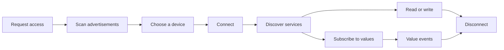

# Bluetooth LE guide

Find nearby Bluetooth LE peripherals, inspect their GATT services, read and write characteristics, and subscribe to changes from a Day app.

The package uses CoreBluetooth on iOS and macOS, Android's Bluetooth GATT APIs, BlueZ on Linux, and WinRT on Windows. It runs through Day's asynchronous bridge and does not require Tokio. Native web and HarmonyOS operations return `ErrorKind::Unsupported`; simulations work independently of native support.

## Scan and connect

```rust,no_run
use day_part_bluetooth::{self as ble, Event, ScanOptions};

async fn scan() -> Result<ble::Watch, ble::Error> {
    let watch = ble::watch(|event| {
        if let Event::Advertisement { advertisement } = event {
            // Send the result to your UI through a Day Setter.
            let _ = advertisement;
        }
    })?;
    ble::request_access().await?;
    ble::start_scan(&ScanOptions::default()).await?;
    Ok(watch)
}
```

Call `request_access()` from a user action before the first scan or connection. It asks for Android's Nearby devices permissions, shows the Apple prompt, and resolves once the adapter reports its state: `Ok` means powered on, a refusal is `PermissionDenied`, and a radio that is off is `PoweredOff`. Creating a watch alone shows no prompt; on Apple platforms its first state event is `Unknown` until access is requested, and operations issued before the state is known wait for it instead of failing.

Keep `Watch` while listening. Call `stop_scan()` when discovery is finished; dropping the watcher removes its subscription but does not stop the shared adapter scan. Service filters and duplicate-advertisement reporting are available through `ScanOptions`.

Device identifiers are opaque and platform-specific. Apple supplies UUIDs, Android supplies addresses that may rotate, and Linux supplies BlueZ object paths. An advertisement is not proof of a peripheral's identity. Connect only after the user chooses an appropriate device.



## UUIDs

Every UUID the package accepts or returns is canonical: lowercase, 128-bit, hyphenated. Pass `180F`, `0000180f`, or a full UUID in either case; compare results against `canonical_uuid("180F")?`. The platforms spell UUIDs differently, and the package absorbs the difference so an app's comparisons work everywhere. Simulations see the spelling the app passed.

## Read, write, and subscribe

After `connect(device).await`, call `services(device).await` to discover services and characteristic properties. Use the returned UUIDs with:

```rust,no_run
# async fn example(device: &str, service: &str, characteristic: &str) -> Result<(), day_part_bluetooth::Error> {
use day_part_bluetooth as ble;
let value = ble::read(device, service, characteristic).await?;
let limit = ble::max_write_length(device, true).await?;
assert!(value.len() <= limit);
ble::write(device, service, characteristic, &value, true).await?;
ble::set_notify(device, service, characteristic, true).await?;
// Event::Value carries subsequent notifications. Disable them when finished.
ble::set_notify(device, service, characteristic, false).await?;
ble::disconnect(device).await?;
# Ok(()) }
```

The final argument to `write` chooses whether the peripheral acknowledges the write. Check the characteristic's properties before choosing. `max_write_length` reports the largest payload the connection carries for each write type; Android negotiates the largest MTU during `connect`, and longer payloads fail with `InvalidArgument` on every platform. The package does not fragment arbitrary large application messages or provide a device-specific protocol.

`Event::Value` carries notifications and indications. The answer to a `read` is returned by that call and does not arrive as an event.

Apple and Android serialize GATT operations per peripheral, with bounded queues; other peripherals can proceed independently. Linux and Windows serialize requests on a worker with a limit of 128 outstanding requests. Disconnects, adapter shutdown, and timeouts fail affected requests. Dropping a future cancels a queued operation; cancelling an active GATT operation closes this client's connection. On Linux cleanup waits for the current D-Bus call to return or time out (up to 45 seconds for a connection). Windows operations have a 30-second deadline, but the OS may continue a connection attempt after the client cancels. A write may already have reached the device. Reconnect before continuing.

Callbacks may run off the UI thread. Copy values into a Day Setter and format localized text on the UI thread. The API identifies characteristics by service and characteristic UUID; it does not distinguish duplicate instances with the same pair of UUIDs.

## Test without Bluetooth hardware

Install a simulation before running application code. The existing API calls use its replies and events without opening a native adapter or requesting OS permissions:

```rust,no_run
use day_part_bluetooth::{self as ble, simulation::{Simulation, Request, Reply}};

let simulation = Simulation::new();
simulation.expect(
    Request::Read {
        device: "test-battery".into(),
        service: "180f".into(),
        characteristic: "2a19".into(),
    },
    Ok(Reply::Value(vec![73])),
);
let _interception = simulation.install(); // Keep this guard for the whole test.
// Existing application code calls ble::read("test-battery", "180f", "2a19").await.
// After it runs, simulation.assert_finished()? verifies the expected request occurred.
```

- `expect` scripts exact requests and replies in order, including deliberate errors.
- `handle` matches requests and computes replies from your fixture's state. `handle_async` can wait on your own test clock or future; cancelling the API call drops that future.
- `simulation.emit` and the handler's `Events` argument deliver advertisements, connection changes, and characteristic values through ordinary `watch` callbacks.
- `requests()` retains the last 256 calls; `request_count()` counts all calls. Use synthetic payloads in fixtures.
- Unmatched calls fail. A mock never silently reaches a real peripheral. Fixtures control their own peripheral state and event timing.

Like HTTP's sessions, `Session::new()` creates an independent routing scope. Use `session.set_simulation(Some(simulation))` and its methods, such as `session.start_scan(&options)` and `session.read(...)`, for parallel tests. Separate sessions do not inherit the global override. Native sessions still share the OS adapter.

An operation captures its backend when first polled. A watch keeps its original backend until dropped. Stop watches and disconnect before changing simulation settings. Scoped overrides restore the prior selection even when nested guards are dropped out of order.

Run the complete [mock peripheral example](../examples/mock_peripheral.rs):

```sh
cargo run --example mock_peripheral
cargo test --test interception
```

The example calls the same permission, connection, service discovery, read, and disconnect functions as device code. The tests also cover scanning, writes, service discovery, notifications, cancellation, parallel sessions, and reentrant callbacks.

## Permissions

Android 12 and later need Nearby devices permissions (`BLUETOOTH_SCAN` and `BLUETOOTH_CONNECT`). Scanning also needs location access unless the app declares `neverForLocation` on `BLUETOOTH_SCAN`. `request_access()` reads that declaration before requesting permissions. The demo opts out of location use in its manifest overlay; Android may filter some beacons as a result. Apps that derive location from scan results must not make that assertion. See [Android Bluetooth permissions](https://developer.android.com/develop/connectivity/bluetooth/bt-permissions).

Apple apps need `NSBluetoothAlwaysUsageDescription`. Put its localized text in the app's resource catalog, as the [demo](../demo/) does. Sandboxed macOS apps also need the Bluetooth entitlement. The package does not enable background scanning or reconnect after a process restart.

Linux needs a running BlueZ service and permission to use it over the system D-Bus. The backend chooses the first powered adapter. Known dual-mode devices with a Classic device class currently return `Unsupported`: explicit LE bearer selection is still needed to avoid BlueZ opening unrelated Classic profiles. LE-only peripherals are supported. The package does not change adapter power, pairing, or system Bluetooth settings. See [BlueZ's connection rules](https://github.com/bluez/bluez/blob/master/doc/org.bluez.Device.rst).

Windows needs a Bluetooth LE adapter and OS permission. Packaged apps must declare `<DeviceCapability Name="bluetooth" />` in their package manifest. Scan before connecting so Windows has the address and address type in its device cache. The backend retains at most 32 connections; the scan cache holds up to 4,096 addresses and resets on a new scan. See [Microsoft's BLE connection API](https://learn.microsoft.com/en-us/uwp/api/windows.devices.bluetooth.bluetoothledevice.frombluetoothaddressasync).

## Demo and software peripheral

Bluetooth Lab scans, lists nearby devices, and inspects the one the user selects. Its separate software-peripheral test exercises discovery, reads, writes, notifications, and disconnects using synthetic data.

On a Mac:

```sh
bash test-peripheral/run-macos.sh
```

On a separate physical Android device:

```sh
cd demo
day launch -t android-material --android-device DEVICE_SERIAL --script dayscript/fixture.yaml
```

Allow Bluetooth access, then choose **Test software peripheral**. The helper advertises `DayBLEFixture` for ten minutes. Its service and characteristic UUIDs are private test identifiers; do not use it for real device data. The test writes only to that fixture service. Simulators generally cannot substitute for physical BLE radios.

For Linux testing, use the Android helper to advertise an LE-only peripheral:

```sh
bash test-peripheral/android/run.sh ANDROID_SERIAL
# On the Linux host with a Bluetooth adapter:
cargo run --example software_peripheral
```

The helper needs Android 12 or later and Android SDK build tools. It installs a disposable `dev.daybrite.blefixture` app, grants its two Bluetooth permissions, and advertises synthetic data for three minutes while its screen stays open. Each build replaces only that test app. Run one fixture at a time. The host example verifies discovery, read, write/read, notifications, and disconnect. A Mac can advertise both Classic and LE transports, which older BlueZ versions may choose incorrectly.

## Checks

```sh
cargo fmt --all -- --check
cargo test
cargo clippy --all-targets -- -D warnings
cd demo
day launch -t macos-appkit --script dayscript/demo.yaml
```

The portable walkthrough checks the UI. The software-peripheral test checks native GATT traffic.
